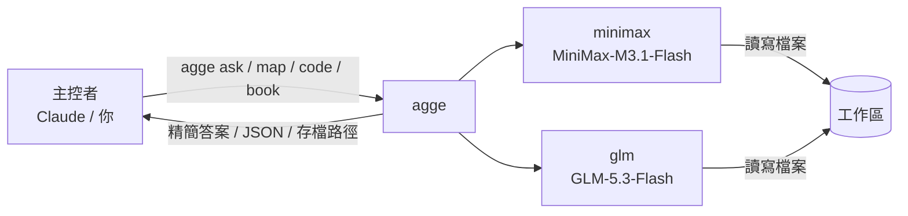

# 用 agge 分派工作給便宜模型

agge 可以當成「工作分派器」：由主控者（人或 Claude Code 這類昂貴的 agent）下指令，讓 MiniMax、GLM 這類便宜模型去讀檔、寫稿、批次處理，主控者只看精簡結果。



## 模型

| 別名 | 實際模型 | 金鑰 | 備註 |
|---|---|---|---|
| `minimax` | `minimax:MiniMax-M3.1-Flash`（api.minimaxi.com） | `MINIMAX_API_KEY` | 回應約 2 秒，預設首選 |
| `glm` | `nvidia:z-ai/glm-5.3-flash` | `NVIDIA_API_KEY` | 免費端點常排隊約 80 秒 |

`-m minimax,glm` 會依序嘗試：第一個失敗（錯誤或額度不足）時自動改用下一個。

## 不需要專案

`agge ask` 和 `agge map` 在任何目錄都能直接用，沒有 `.agge/` 時會套用內建預設（有 `MINIMAX_API_KEY` 就用 minimax），也不會建立 `.agge/`。

## `agge ask`：單一任務

```bash
agge ask -q "問題"                              # 只輸出最終答案，不顯示過程
agge ask --no-tools -f src/a.py -f 'doc/*.md' "摘要這些檔案"   # 附加檔案內容，純 LLM 回答
agge ask --brief 5 "..."                        # 要求答案不超過 5 行
agge ask --json "..."                           # {"answer","agent","model","files_changed","secs"}
agge ask -y --save out/report.md "讀 src/ 並寫一份架構報告"     # 答案寫入檔案，只印一行摘要
agge ask -y -t code --json "實作 X 並跑測試"     # 團隊模式：lead 分派給 architect/coder/tester/reviewer
```

* `--save` 與 `--json` 讓主控者不必閱讀長篇輸出；`files_changed` 列出 agent 寫入或修改過的檔案，方便只檢查那些檔案。
* 沒有 `--no-tools` 時，agent 可以自己 `read_file`／`search`／`write_file`；需要執行 shell 時要加 `-y`（非互動模式下預設拒絕）。

## `agge map`：平行批次

同一個提示套用到多個檔案（或 stdin 的每一行），平行執行：

```bash
agge map "用一句話描述這個檔案" 'src/**/*.py' --brief 1          # 每個檔案一段結果
agge map "把 {{file}} 翻成英文" 'chapters/*.md' -d en --ext .md   # 每個結果寫成 en/<name>.md
agge map --json "審查這個檔案的錯誤" 'agge/*.py' -j 8             # 每項一行 JSON
ls *.csv | agge map --lines "說明 {{item}} 的用途" --json          # 從 stdin 讀項目
```

樣板變數：`{{file}}`、`{{name}}`（檔名不含副檔名）、`{{content}}`、`{{item}}`、`{{index}}`。提示中沒用到 `{{content}}` 或 `{{file}}` 時，檔案內容會自動附加。預設不使用工具（純轉換、最快），需要時加 `--tools`。

## 大型工作

```bash
agge code -y "需求" -o 目錄 -m minimax -M review=glm     # 設計→實作→測試→審查
agge book -y "主題" -o 目錄 --chapters 10 --lang 繁體中文  # 大綱→各章平行撰寫→編輯
agge log last review                                     # 只看某個節點的輸出
```

## 建議做法

1. 讀大量檔案、寫初稿、翻譯、摘要 → 交給 `ask`／`map`，結果存檔或用 `--brief` 限制長度。
2. 主控者只檢查 `files_changed` 與測試結果，而不是重讀全部內容。
3. 品質要求高的步驟（例如審查）可用 `-M review=另一個模型` 讓不同模型交叉檢查。

## 給 Claude Code 用的 skill

`skills/cheap-llm/SKILL.md` 是一個 Claude Code skill，教 Claude 何時、如何用 agge 把工作交給便宜模型。安裝方式：

```bash
ln -sfn "$PWD/skills/cheap-llm" ~/.claude/skills/cheap-llm
```

再在 `~/.claude/CLAUDE.md` 加一段規定，要求每個任務都先考慮分派給便宜模型，並指向這個 skill。
