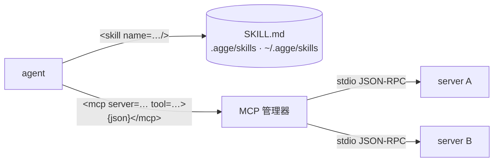

# Skills 與 MCP

agge 的 agent 除了內建檔案／shell 工具之外，還可以使用：

* **Skills**：可重複使用的說明書（`SKILL.md`），格式與 Claude Code／Anthropic Agent Skills 相同。
* **MCP**：透過 [Model Context Protocol](https://modelcontextprotocol.io) 連接外部工具伺服器（stdio）。



## Skills

### 漸進式載入

system prompt 只放每個 skill 的 `name: description`（一行），agent 判斷需要時才用 `<skill name="..."/>` 載入完整內容，避免浪費 token。載入結果包含 `SKILL.md` 本文，以及 skill 目錄內其他檔案的路徑（agent 可以再用 `read_file` 讀取或用 `shell` 執行裡面的腳本）。

### 搜尋路徑（後者覆蓋前者）

1. `~/.agge/skills/`（使用者層級，`$AGGE_HOME/skills`）
2. 設定 `skill_dirs` 列出的目錄
3. `.agge/skills/`（專案層級）

例如沿用 Claude Code 的 skills：

```bash
agge config skill_dirs '["~/.claude/skills"]'
```

### 指令

```bash
agge skill list                       # 列出所有 skill
agge skill show <name>                # 顯示完整內容（agent 載入時看到的就是這個）
agge skill new <name> --description "做什麼、何時使用"          # 建在 .agge/skills/
agge skill new <name> --description "..." --global             # 建在 ~/.agge/skills/
agge skill dirs                       # 顯示搜尋路徑
```

### SKILL.md 格式

```markdown
---
name: review-style
description: 依照團隊風格審查 Python 程式碼時使用
---
# Review style

## Instructions
1. ...
```

`description` 決定 agent 會不會想到要用它，請寫清楚「做什麼」和「什麼時候用」。

## MCP

### 設定

伺服器設定存在 `.agge/config.json` 的 `mcp` 欄位（也可以放在 `~/.agge/config.json` 共用）：

```bash
agge mcp add fs -- npx -y @modelcontextprotocol/server-filesystem /path/to/dir
agge mcp add gh --env GITHUB_TOKEN=xxx -- github-mcp-server stdio
agge mcp import ~/Library/Application\ Support/Claude/claude_desktop_config.json   # 匯入 mcpServers
agge mcp import .mcp.json
agge mcp list
agge mcp rm fs
```

對應的 JSON：

```json
{
  "mcp": {
    "fs": {"command": "npx", "args": ["-y", "@modelcontextprotocol/server-filesystem", "/path"], "env": {}},
    "old": {"command": "x", "disabled": true}
  }
}
```

### 測試與手動呼叫

```bash
agge mcp tools            # 列出所有 server 的工具（agent 在 system prompt 看到的就是這份清單）
agge mcp tools fs         # 只看某個 server
agge mcp call fs read_text_file '{"path": "/path/README.md"}'
```

### agent 怎麼用

有設定 server 時，具有 `mcp` 工具的 agent（assistant、coder、tester、writer…）會在 system prompt 看到：

```
## MCP tools
- fs.read_text_file: Read the complete contents of a file ... (args: path*, head, tail)
```

並用下列標籤呼叫，結果以 `<tool_result name="mcp">` 回傳：

```xml
<mcp server="fs" tool="read_text_file">{"path": "/path/README.md"}</mcp>
```

伺服器在第一次需要時才啟動，程式結束時自動關閉。啟動失敗的 server 會在清單中標示 `(unavailable: …)`，不影響其他工具。

### 限制

* 目前只支援 stdio 傳輸（不支援 HTTP／SSE 型 MCP server）。
* 只使用 MCP 的 tools；resources、prompts 尚未支援。

## 控制哪些 agent 能用

skill 與 mcp 是一般工具名稱，可以用 `agge agent add` 調整：

```bash
agge agent add researcher --base assistant --tools read_file,search,skill,mcp
```

沒有任何 skill 或 MCP server 時，這兩個工具會自動從 agent 移除，不佔 system prompt。
